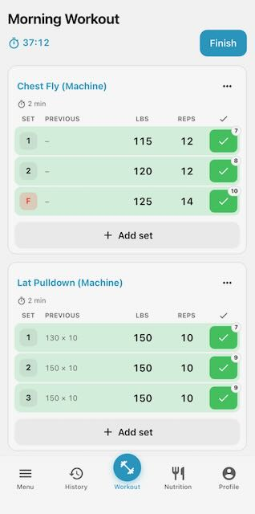
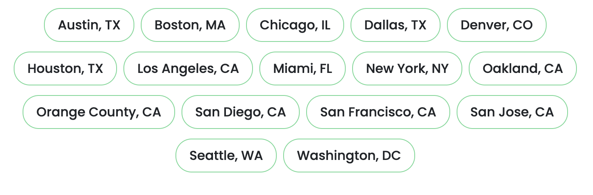

#  Health Assistant v.1.0

[](LICENSE)
[](https://www.home-assistant.io/)
[](#localization)


Workout, Nutrition, and Health Datapoint logging inside of Home Assistant. Track workouts, personal records, count calories, and meet your goals without compromising your data. 

> **IMPORTANT NOTICE**
> 
> ⚠️ **This integration is _<ins>NOT</ins>_ able to run offline in the companion app.**
> Health Assistant requires a connection to your Home Assistant server to run in the companion app. While most gyms have free wifi for members, please keep this in mind when using. This integration has been developed for web and the iOS companion app.

## Screenshots:


------

 


## Installation

[](https://my.home-assistant.io/redirect/hacs_repository/?owner=tjsanzen&repository=health-assistant&category=integration)

> **CREATOR RECOMMENDATION:**
> 
> By default, there are two different calculations for BMR built in, one with body fat percentage and one without. If you have access to a DEXA scan or similar method to find your exact body fat percentage, I highly recommend it. If you live in one of the cities below, I recommend BodySpec, it is really affordable. Please use my referral link if you're willing to! [BodySpec Sign-Up](https://www.bodyspec.com/r/wZJdna)
>  


## What's in Health Assistant v1.0

**Health Assistant** has four primary views, each serving a different function in your health journey. 

| Tab | What it does |
| --- | --- |
| **Learn** | A couple of conditional cards will pop-up with suggestions about your current data, otherwise has some lessons that I've written for users who might be new to working out or health tracking. If you want to modify them for all users, please reach out to me or open a request on GitHub, I'd love to collaborate. |
| **Workout** | Allows you to log workouts, run rest timers, view history and records. |
| **Nutrition** | Daily macros and calories tracking. I used the OpenNutrition database as my source, and will update it whenever it gets updated. However, you can also add custom foods. There is a barcode scanner, but it is hidden in settings and turned off by default, as research notes calorie tracking apps can make people over reliant on foods that are easy to track and manufactured. |
| **Profile** | Weight progress toward your target with a trend chart, health-stat tiles (weight, body fat, BP, heart rate, HRV, SpO₂, respiration, height) with history, daily targets (calculated, or set your own calories and protein/carbs/fat), workout & rest-timer settings, and profile editing. |

## Setup and Sensors

**Setup flow** asks for name, linked HA user, units, current and target weight, height, body fat % (optional), age, sex, average daily steps, weekly 1-hour lifting days and goal pace. It then shows your numbers before you confirm, where you can change them if you'd like... however, I wouldn't recommend doing so unless you know what you are doing. I've spent a significant amount of time and research refining these calculations.

**Sensors** (per profile): calories today/remaining, calorie target, maintenance, BMR, protein/carbs/fat today, weight, body fat, heart rate, blood pressure, last workout, workouts this week.

## Dashboard cards

There are a number of built in cards that you can use for your own health and fitness dashboards. Something that would maybe be really cool on a smart display in a home gym. Find them under **Add card**, or add them in YAML:

```yaml
type: custom:health-assistant-lift-calendar   # this month, days you lifted circled in green
---
type: custom:health-assistant-calorie-gauge   # today's calories as a speedometer against your target
---
type: custom:health-assistant-log-meal        # a button that opens the "Log a meal" dialog
name: Log meal                                # optional
icon: mdi:silverware-fork-knife               # optional
---
type: custom:health-assistant-nutrition-today     # today's calorie ring with protein, carbs, fat and fiber bars
---
type: custom:health-assistant-nutrition-averages  # average calories and macros over 7 days, 30 days and all time
---
type: custom:health-assistant-calorie-history     # last 14 days against target and maintenance
show_fat_burned: true                             # optional, the "estimated fat burned this week" box
show_streak: true                                 # optional, the streak and on-target tiles
---
type: custom:health-assistant-exercise-progress   # one exercise over time
exercise_name: bench_press                        # id or name; the closest match is used
time: 30                                          # days, or 'all_time'
metric: e1rm                                      # optional: e1rm, weight, volume, reps
```

- **Profile:** every card takes an optional `profile: Name` (a profile name or id). By default it uses the profile linked to whoever is signed in, but if you have multiple users, this might be useful. 
- **Title:** every card except the log-meal button takes an optional `title:`.
- **Exercise progress:** one point per workout, from your best working set (warm-ups don't count). The default metric is estimated 1RM for weighted lifts, reps for bodyweight exercises, and time or distance for cardio. The highest point is gold, and the header shows your latest value and the change since the first point in range. `exercise_name` accepts an id (`bench_press`), a name (`Bench Press`) or something close: `tricep_pushdown_machine` finds Tricep Pushdown if that makes sense.
- **Nutrition cards:** the same views as the Nutrition tab's sidebar. They update when food is logged anywhere.
- **Gauge colours:** blue up to 90% of your target, green within ±10%, red when you're over.
- **Log a meal dialog:** OpenNutrition search, recent foods and Quick add, logged to the meal you pick.


## More than one person

Each person gets their own profile, linked to their Home Assistant user. Whoever opens **Health** in the sidebar sees their own data.

1. Make sure each person has their own Home Assistant user (Settings → People) and signs in with it on their phone.
2. Add the integration again for each person (Settings → Devices & services → Add integration → Health Assistant), and pick their user under **Linked user**.
3. To change who a profile belongs to later, an admin opens that profile and goes to **Profile → Home Assistant user**.

Non-admin users only ever see their own profile. Admins can switch between all profiles with the picker in the header. Each visit starts on your own profile, and a switch only lasts for that browser tab. A user with no linked profile is asked to have an admin set one up.

Dashboard cards show the viewer's own profile unless the card sets `profile:`. For non-admin users, a card set to someone else's profile should show an error.

## Importing your workout history (Strong App)

Profile → Settings → **Import workout history** → pick a CSV exported from the Strong app (Settings → Export Data). Currently only supports Strong because that is what I used prior to building this.

- **Preview first:** you see how many workouts and sets are new, the date range, and how every Strong exercise name was matched, however nothing is saved until you press **Import**.
- **Matching:** Strong's names are matched with a built-in table, for example "Bench Press (Barbell)" → Bench Press and "Seated Row (Cable)" → Seated Cable Row. Anything not in the table falls back to the closest library name. Anything still left becomes a custom exercise with its Strong name.
- **What's kept:**
  - warm-up, failure and drop sets (W / F / D);
  - effort (RPE) and set notes;
  - the rest timer, used as each exercise's rest;
  - cardio distance and time.
- **Calories and PRs:** each imported workout gets calories from the engine, fitted to the workout's real length, and PRs judged against everything before it.
- **Safe to re-run:** importing the same file again skips workouts already imported. **Remove all imported Strong workouts** undoes it without touching workouts you logged in Health Assistant!

## Rest-over sound in your headphones

When a rest timer ends, Health Assistant sends your phone a notification with a sound, so you hear it through your headphones even when the app is closed. Pick the sound in **Profile → Phone, rest timer & Apple Health → Sound when rest is over**:

- **Chime**: the same chime the panel plays. Import it into the Companion app once: tap *download the chime file* in that sheet, save `health_assistant_chime.wav` to Files or iCloud Drive, then in the Home Assistant app go to **Settings → Companion app → Notifications → Sounds → Import custom sound**, pick the file, and restart the iPhone. Until it's imported, iOS plays its default sound.
- **iPhone default sound**: the standard notification tone.
- **No sound**: the Live Activity update only vibrates the phone.

The notification is time-sensitive, so it gets through Focus modes. I've only tested this on iPhone as that is all I have. 

## Steps from your phone (iPhone or Android)

When you pick your phone during setup, Health Assistant connects that phone's best Companion app step sensor. You can change it under Profile → Phone, rest timer & Apple Health.

| Phone | Sensor | Counts |
| --- | --- | --- |
| Android | **Health Connect daily steps** (preferred) | Steps since midnight from Health Connect, so a watch or fitness app that syncs there is included. Needs Health Connect permission in the Companion app. |
| iPhone | **Apple Health steps** (preferred) | Steps since midnight from Apple Health, including an Apple Watch. |
| iPhone | Pedometer **Steps** | Steps the iPhone itself detects. |
| Android | Phone pedometer **Steps sensor** | Counts up from the last reboot. Health Assistant adds each increase to the day's total, so it starts counting from the first reading after you connect it. |

- Health Assistant keeps one total per day.
- Once 3 days are recorded, your 14-day average replaces the steps you entered at setup in the maintenance-calorie estimate.
- The Steps tile on the Profile tab shows today's count, your average and the last 30 days.
- Sensors: `Steps today` and `Average steps`.

If a sensor is missing, turn it on in the Companion app under Settings → Companion app → Sensors. On Android, the pedometer updates every 15 minutes by default per documentation; you can make it faster under Sensor Update Frequency.

## How numbers are calculated

- **BMR**: Katch-McArdle (`370 + 21.6 × lean mass kg`) when body fat is known, otherwise Mifflin-St Jeor. Again, I really recommend getting a [DEXA scan](https://www.bodyspec.com/r/wZJdna) as the Katch-McArdle is so much more accurate.
- **Maintenance (TDEE)**: `BMR × 1.2` (sedentary baseline, includes digestion and ~3,000 steps)
  - steps above 3,000 × 0.0005 kcal × body weight (kg) (≈0.04 kcal/step at 80 kg)
  - lifting days × 4 net METs × body weight (kg) ÷ 7
  
  The implied activity multiplier and label (Sedentary → Extremely active) are shown in the panel.
- **Target**: maintenance ± (goal pace × 7,700 kcal/kg ÷ 7). The direction comes from target vs current weight; within 0.5 kg counts as maintain. The target never drops below 1,500 kcal (male) or 1,200 kcal (female).
- **Lifting**: until you've been logging workouts for 2 weeks, lifting calories come from the "days per week" setup answer, at 1 hour each. After that, they're the active calories of your logged workouts (see below), averaged over the last 4 weeks. The setup answer is then locked, and the Profile shows your lifting kcal/day.
- **Protein**: 0.6 g per lb of body weight, or 0.9 g/lb if your latest body fat is under 15%.
- **Carbs**: set by how much you train, per lb of body weight. Training time is your logged workouts (4-week average) once 2 weeks are logged; until then it's your lifting days × 1 hour.

  | Exercise | Average training per day | Carbs per lb of body weight |
  | --- | --- | --- |
  | Light | Low intensity (under 45 min) | 1.5–2.5 g |
  | Moderate | Around 1 hour (45 min–1.5 h) | 2.5–3.5 g |
  | High | 1–3 hours, moderate–high intensity (1.5–3.5 h) | 3–5 g |
  | Very high | 4–5 hours, moderate–high intensity (3.5 h+) | 4–6 g |

- **Fat** fills the calories left after protein and carbs, kept between 20% and 35% of calories. It starts at 25%, then moves calories between fat and carbs to bring carbs inside the range. If your calorie target is too low to reach the bottom of the carb range with fat at 20%, carbs are set as high as the target allows, and the Profile tab says so.
- **Deficit warning**: if a target works out to more than 600 kcal/day below maintenance, Health Assistant shows a warning you can override. This applies in setup, under Daily targets and under Body & goal.
- **Manual targets** (Profile → Daily targets → Edit) replace any of these. With only calories set, protein stays calculated and fat and carbs are fitted as above. With fixed carbs or fat, the other one takes whatever calories are left.
- **Nutrition averages** count only days you logged something, and leave out today because it isn't finished.
- Current weight, body fat and height always come from your **latest logged health stat**, so the targets update as you log.
- Records ignore warm-up sets. Estimated 1RM uses Epley: `w × (1 + reps/30)`.


### Workout calories

Every finished workout gets a set-by-set estimate instead of "time × one MET value":

```
calories = Σ  MET × body weight (kg) × minutes / 60      over every set, rest and transition
```

- **Each set** is reps × 4 s plus 10 s to unrack and brace (or the logged time for timed and cardio exercises), at the exercise's MET × an effort multiplier.
- **Exercise MET**, from `tier` in `exercises.json`:

  | Tier | Type | Examples | MET during the set |
  | --- | --- | --- | --- |
  | 1 | Heavy full-body | squat, deadlift, RDL | 8.0 |
  | 2 | Compound | bench, overhead press, rows, pull-ups | 6.0 |
  | 3 | Machine or supported compound | leg press, lunges, cable row | 5.0 |
  | 4 | Isolation | curls, raises, extensions | 4.0 |

  Cardio and core entries set an exact `base_met` instead. Custom exercises ask for a type when you create them.
- **Effort**: RPE 6–7.5 ×1.0, 8–9 ×1.1, 9.5–10 ×1.2, under 6 ×0.85. A set without an RPE uses its type: warm-up ×0.85, drop ×1.1, failure ×1.2.
- **Rest** between sets of the same exercise burns 75% of the set's intensity (minimum 1.5 METs), because breathing and heart rate stay up after a hard set. That applies for your rest timer plus 60 seconds. Anything longer counts as idle at 1.2 METs, capped at 20 minutes per gap.
- **Moving to the next exercise**: the rest, then a 2-minute transition at 2.0 METs. Switching between superset partners gets 1 minute at 2.0.
- **Before the first set** up to 5 minutes counts at 2.0 METs. **After the last set** 2 minutes counts at 2.0, and anything beyond is idle, capped at 10 minutes in case Finish was pressed late.
- **Timing**: ticking a set records its time, so real rest lengths are used. Workouts logged before this update assume you rested exactly as planned.
- **Results**: workouts show **active** calories (above resting, like Apple Watch's Active Energy) and **total** calories. Maintenance calories and Apple Health use active, so nothing is counted twice.
- **Calibration**: the published MET tiers (7/5/4/3) with rest at a flat 1.5 METs gave whole-session averages around 2 METs. Measured values are higher. The 2024 Compendium of Physical Activities lists ~3.5 METs for moderate multi-exercise training, 5.0 for squats and deadlifts, and 6.0 for vigorous lifting. With the tiers above and rest at 75%, a typical 55-minute session at 80 kg comes out at about 3.9 METs for a moderate push day (~210 active kcal), 4.7 for a hard leg day (~280) and 3.0 for arms (~150). No single segment exceeds 12 METs.

### Data model

Everything for a profile lives in `.storage/health_assistant.<entry_id>` (included in HA backups), stored in metric units:

- `profile`: name, linked user, units, sex, age, height, target weight, steps, lifting days, goal pace
- `food_log[]`: date, meal, name, brand, amount + unit (serving / g / oz / quick), grams, kcal, protein, fat, carbs, fiber
- `custom_foods[]`, `recent_foods[]`
- `vitals[]`: type (weight, height, body_fat, blood_pressure, heart_rate, respiration, hrv, spo2), value(s), unit, recorded_at, note
- `workouts[]`: name, started/ended, notes, exercises[] → sets[] (type, weight, reps, rpe, duration_s, distance_m), PRs, summary
- `templates[]`, `custom_exercises[]`, `active_workout`

## Data source

Food data comes from [OpenNutrition](https://www.opennutrition.app). Check their license terms for attribution requirements before you redistribute the built `foods.db`.

Chime noise: Music by <a href="https://pixabay.com/users/freepalestine_loverespect-55896143/?utm_source=link-attribution&utm_medium=referral&utm_campaign=music&utm_content=585518">love respect</a> from <a href="https://pixabay.com/music//?utm_source=link-attribution&utm_medium=referral&utm_campaign=music&utm_content=585518">Pixabay</a>

Icon and asset design by myself in Canva.
