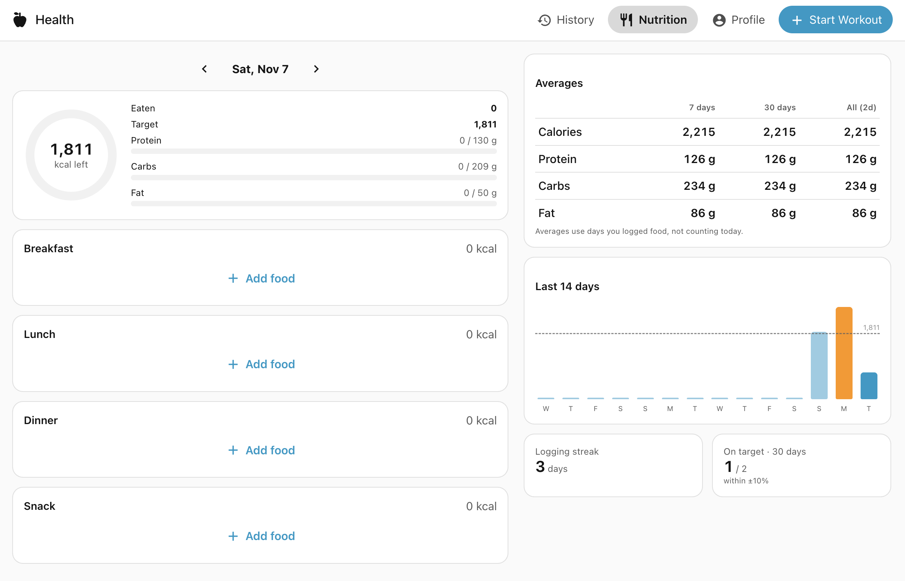
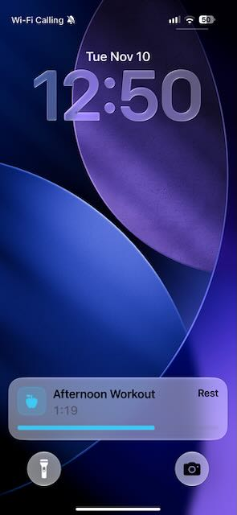
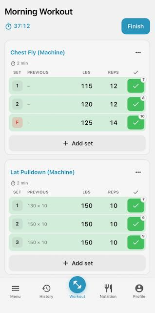
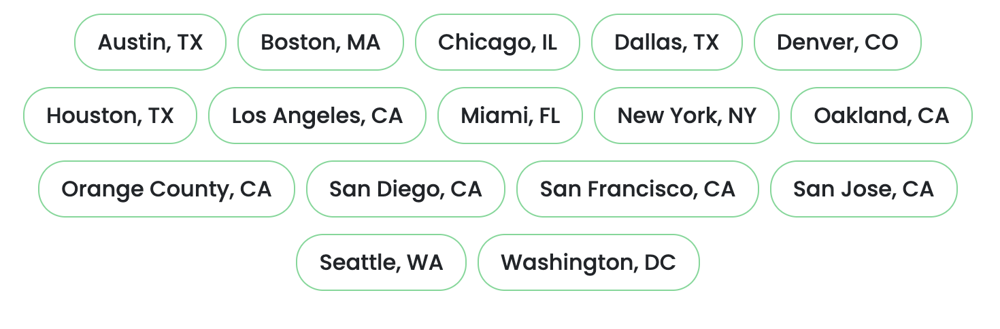

#  Health Assistant

[](LICENSE)
[](https://www.home-assistant.io/)
[](#localization)


Workout, Nutrition, and Health Datapoint logging inside of Home Assistant. Track workouts, personal records, count calories, and meet your goals without compromising your data. 

> **IMPORTANT NOTICE**
> 
> ⚠️ **This integration is _<ins>NOT</ins>_ able to run offline.**
> Health Assistant requires a connection to your Home Assistant server to run. While most gyms have free wifi for members, please keep this in mind when using. This integration has been developed for web and the iOS companion app.

## Screenshots:



 


## Installation

[](https://my.home-assistant.io/redirect/hacs_repository/?owner=tjsanzen&repository=health-assistant&category=integration)

> **CREATOR RECOMMENDATION:**
> 
> By default, there are two different calculations for BMR built in, one with body fat percentage and one without. If you have access to a DEXA scan or similar method to find your exact body fat percentage, I highly recommend it. If you live in one of the cities below, I recommend BodySpec, it is really affordable. Please use my referral link if you're willing to! [BodySpec Sign-Up](https://www.bodyspec.com/r/wZJdna)
>  


## What's in Health Assistant v0.2.1

**Health Assistant** has four primary views, each serving a different function in your health journey. 

| Tab | What it does |
| --- | --- |
| **History** | Past workouts grouped by month (duration, volume, sets, PRs), workout detail, save a workout as a template, delete. A **Records** view shows per-exercise bests (heaviest, estimated 1RM, best set) and an e1RM trend. |
| **Start Workout** | Start empty or from a template. Each exercise has a **•••** menu (add warm-up set, update rest timer, replace exercise, create superset, remove exercise) and a Set / Previous / lbs / Reps / ✓ table. Tap a set number to make it a working set, warm-up (yellow), drop set (purple) or failure (red). Previous shows what you did on the same set last time. Typing reps into one set fills the blank sets below it. Ticking a set asks for effort (6–10), then starts that exercise's rest timer (default 2 min). Rest only starts after the last exercise of a superset. In-progress workouts are saved to HA, so you can start on your phone and finish on your laptop. |
| **Nutrition** | Daily calorie ring and macro bars, meals (breakfast / lunch / dinner / snack), food search across ~327k OpenNutrition foods, recent foods, quick add, custom foods, edit and delete, previous days. Stats: average calories/protein/carbs/fat over 7 days, 30 days and all time, a 14-day chart against your target, logging streak and days on target. On desktop the stats sit in a right-hand column. |
| **Profile** | Weight progress toward your target with a trend chart, health-stat tiles (weight, body fat, BP, heart rate, HRV, SpO₂, respiration, height) with history, daily targets (calculated, or **set your own** calories and protein/carbs/fat), workout & rest-timer settings, and profile editing. |

## Setup and Sensors

**Setup flow** asks for name, linked HA user, units, current and target weight, height, body fat % (optional), age, sex, average daily steps, weekly 1-hour lifting days and goal pace. It then shows your numbers before you confirm.

**Sensors** (per profile): calories today/remaining, calorie target, maintenance, BMR, protein/carbs/fat today, weight, body fat, heart rate, blood pressure, last workout, workouts this week.

## Dashboard cards

The integration loads three cards on every dashboard, so there's no resource to add. Find them under **Add card**, or add them in YAML:

```yaml
type: custom:health-assistant-lift-calendar   # this month, days you lifted circled in green (‹ › to change month)
---
type: custom:health-assistant-calorie-gauge   # today's calories as a speedometer against your target
---
type: custom:health-assistant-log-meal        # a button that opens a "Log a meal" dialog
name: Log meal                                # optional
icon: mdi:silverware-fork-knife               # optional
```

- **Profile:** every card takes an optional `profile: Anna` (a profile name or id). By default it uses the profile linked to whoever is signed in.
- **Title:** the calendar and gauge also take an optional `title:`.
- **Gauge colours:** blue up to 90% of your target, green within ±10%, red when you're over.
- **Log a meal dialog:** OpenNutrition search, recent foods and Quick add, logged to the meal you pick.

## Steps from your iPhone

When you pick your phone during setup, Health Assistant connects that phone's Companion app step sensor (`sensor.<phone>_steps`). You can change it under Profile → iPhone, rest timer & Apple Health.
- Health Assistant keeps one total per day.
- Once 3 days are recorded, your 14-day average replaces the steps you entered at setup in the maintenance-calorie estimate.
- The Steps tile on the Profile tab shows today's count, your average and the last 30 days.
- New sensors: `Steps today` and `Average steps`.

The sensor counts steps your iPhone detects, not your Apple Watch. If it's missing, turn it on in the Companion app under Settings → Companion app → Sensors.

## How numbers are calculated

- **BMR**: Katch-McArdle (`370 + 21.6 × lean mass kg`) when body fat is known, otherwise Mifflin-St Jeor. Again, I really recommend getting a [DEXA scan](https://www.bodyspec.com/r/wZJdna) as the Katch-McArdle is so much more accurate.
- **Maintenance (TDEE)**: `BMR × 1.2` (sedentary baseline, includes digestion and ~3,000 steps)
  - steps above 3,000 × 0.0005 kcal × body weight (kg) (≈0.04 kcal/step at 80 kg)
  - lifting days × 4 net METs × body weight (kg) ÷ 7
  
  The implied activity multiplier and label (Sedentary → Extremely active) are shown in the panel.
- **Target**: maintenance ± (goal pace × 7,700 kcal/kg ÷ 7). The direction comes from target vs current weight; within 0.5 kg counts as maintain. The target never drops below 1,500 kcal (male) or 1,200 kcal (female).
- **Lifting**: until you've been logging workouts for 2 weeks, lifting calories come from the "days per week" setup answer, at 1 hour each. After that, they're the active calories of your logged workouts (see below), averaged over the last 4 weeks. The setup answer is then locked, and the Profile shows your lifting kcal/day.
- **Protein**: 0.6 g per lb of body weight, or 0.9 g/lb if your latest body fat is under 15%. Fat is 25% of calories and carbs are the rest.
- **Deficit warning**: if a target works out to more than 600 kcal/day below maintenance, Health Assistant shows a warning you can override. This applies in setup, under Daily targets and under Body & goal.
- **Manual targets** (Profile → Daily targets → Edit) replace any of these. With only calories set, protein stays calculated, fat is 25% and carbs fill the rest; with fixed protein/fat, carbs fill whatever calories are left.
- **Nutrition averages** count only days you logged something, and leave out today because it isn't finished.
- Current weight, body fat and height always come from your **latest logged health stat**, so the targets update as you log.
- Records ignore warm-up sets. Estimated 1RM uses Epley: `w × (1 + reps/30)`.


### Workout calories

Every finished workout gets a set-by-set estimate instead of "time × one MET value":

```
calories = Σ  MET × body weight (kg) × minutes / 60      over every set, rest and transition
```

- **Each set** is reps × 4 s plus 10 s to unrack and brace (or the logged time for timed and cardio exercises), at the exercise's MET × an effort multiplier.
- **Exercise MET**, from `tier` in `exercises.json`:

  | Tier | Type | Examples | MET during the set |
  | --- | --- | --- | --- |
  | 1 | Heavy full-body | squat, deadlift, RDL | 8.0 |
  | 2 | Compound | bench, overhead press, rows, pull-ups | 6.0 |
  | 3 | Machine or supported compound | leg press, lunges, cable row | 5.0 |
  | 4 | Isolation | curls, raises, extensions | 4.0 |

  Cardio and core entries set an exact `base_met` instead. Custom exercises ask for a type when you create them.
- **Effort**: RPE 6–7.5 ×1.0, 8–9 ×1.1, 9.5–10 ×1.2, under 6 ×0.85. A set without an RPE uses its type: warm-up ×0.85, drop ×1.1, failure ×1.2.
- **Rest** between sets of the same exercise burns 75% of the set's intensity (minimum 1.5 METs), because breathing and heart rate stay up after a hard set. That applies for your rest timer plus 60 seconds. Anything longer counts as idle at 1.2 METs, capped at 20 minutes per gap.
- **Moving to the next exercise**: the rest, then a 2-minute transition at 2.0 METs. Switching between superset partners gets 1 minute at 2.0.
- **Before the first set** up to 5 minutes counts at 2.0 METs. **After the last set** 2 minutes counts at 2.0, and anything beyond is idle, capped at 10 minutes in case Finish was pressed late.
- **Timing**: ticking a set records its time, so real rest lengths are used. Workouts logged before this update assume you rested exactly as planned.
- **Results**: workouts show **active** calories (above resting, like Apple Watch's Active Energy) and **total** calories. Maintenance calories and Apple Health use active, so nothing is counted twice.
- **Calibration**: the published MET tiers (7/5/4/3) with rest at a flat 1.5 METs gave whole-session averages around 2 METs. Measured values are higher. The 2024 Compendium of Physical Activities lists ~3.5 METs for moderate multi-exercise training, 5.0 for squats and deadlifts, and 6.0 for vigorous lifting. With the tiers above and rest at 75%, a typical 55-minute session at 80 kg comes out at about 3.9 METs for a moderate push day (~210 active kcal), 4.7 for a hard leg day (~280) and 3.0 for arms (~150). No single segment exceeds 12 METs.

### Data model

Everything for a profile lives in `.storage/health_assistant.<entry_id>` (included in HA backups), stored in metric units:

- `profile`: name, linked user, units, sex, age, height, target weight, steps, lifting days, goal pace
- `food_log[]`: date, meal, name, brand, amount + unit (serving / g / oz / quick), grams, kcal, protein, fat, carbs, fiber
- `custom_foods[]`, `recent_foods[]`
- `vitals[]`: type (weight, height, body_fat, blood_pressure, heart_rate, respiration, hrv, spo2), value(s), unit, recorded_at, note
- `workouts[]`: name, started/ended, notes, exercises[] → sets[] (type, weight, reps, rpe, duration_s, distance_m), PRs, summary
- `templates[]`, `custom_exercises[]`, `active_workout`

## Data source

Food data comes from [OpenNutrition](https://www.opennutrition.app). Check their license terms for attribution requirements before you redistribute the built `foods.db`.

Chime noise: Music by <a href="https://pixabay.com/users/freepalestine_loverespect-55896143/?utm_source=link-attribution&utm_medium=referral&utm_campaign=music&utm_content=585518">love respect</a> from <a href="https://pixabay.com/music//?utm_source=link-attribution&utm_medium=referral&utm_campaign=music&utm_content=585518">Pixabay</a>

Icon and asset design by myself in Canva.
